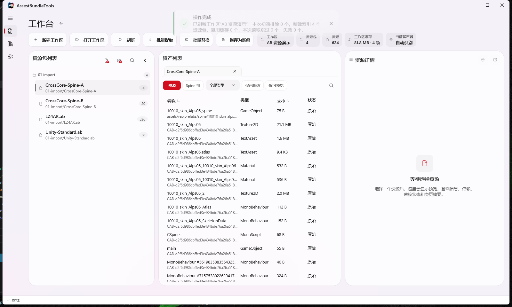
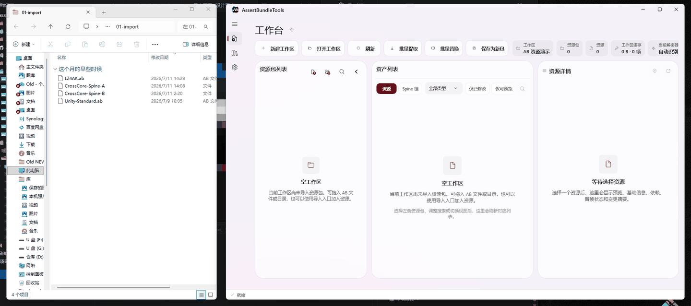
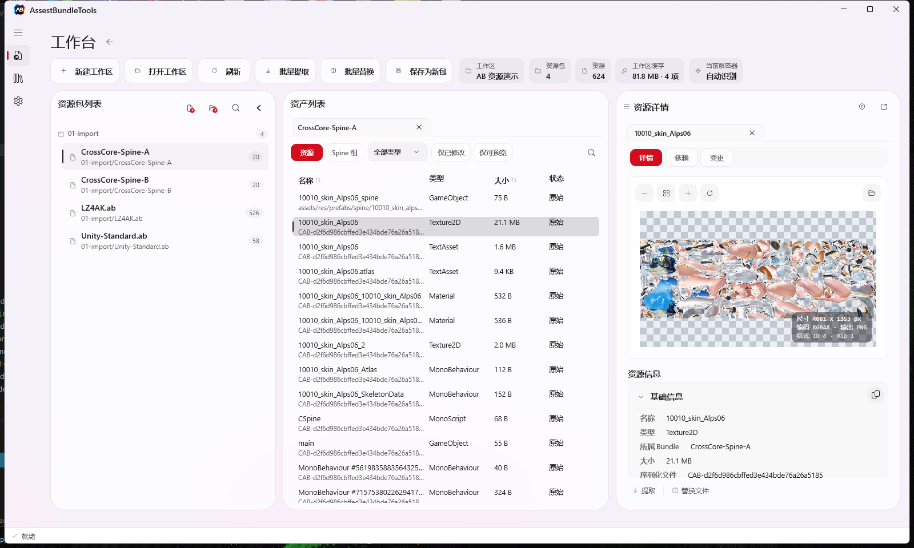
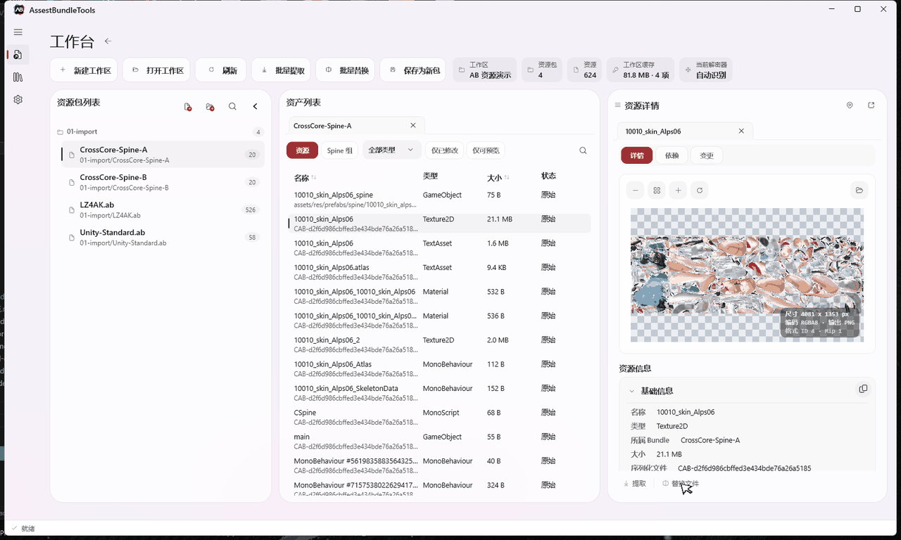
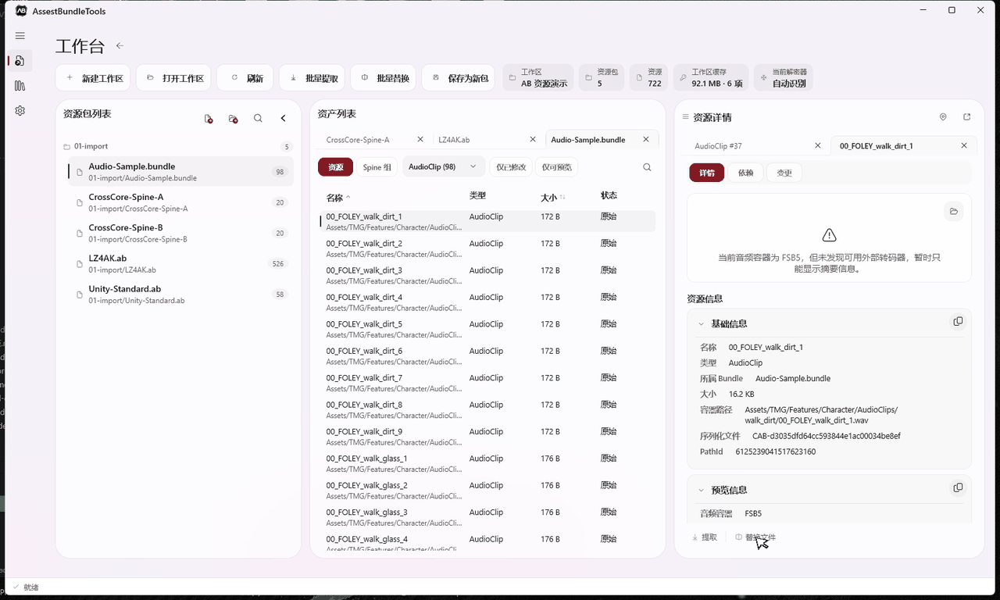
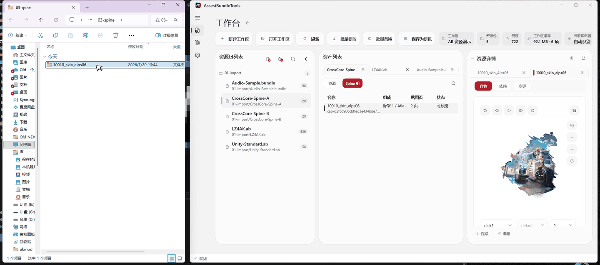
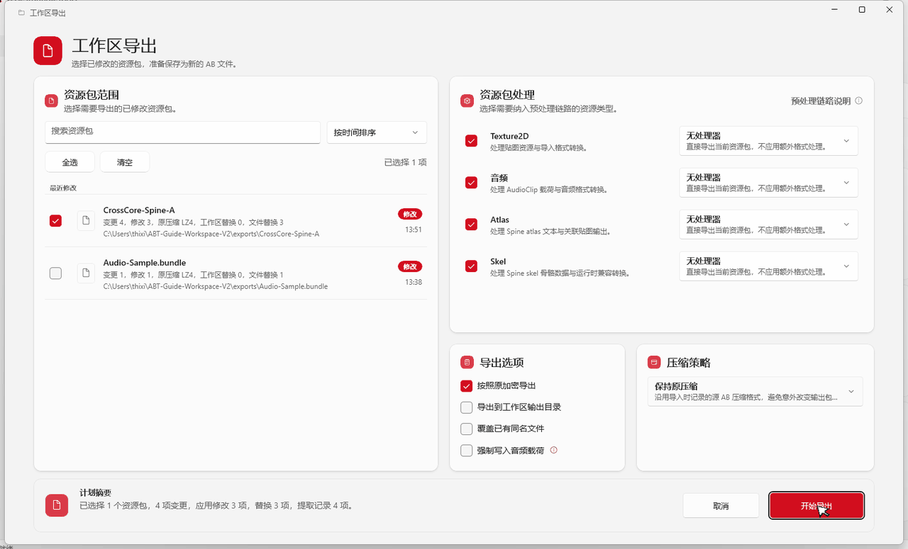

<p align="center">
  
</p>

# AssestBundleTools

[English](README.en.md) | 简体中文

AssestBundleTools 是一款面向 Unity AssetBundle 的 Windows 工作区工具，用于识别、浏览、预览、提取、替换并重新构建游戏资源包。项目重点处理加密 AB、资源关联、可恢复修改记录和原加密方式导出等实际模组工作流。

> 项目仍处于预览阶段。请保留原始资源备份，并在游戏内实际验证重新构建的资源包。

> [查看完整图文使用指南](docs/user-guide.md)：包含新建工作区、拖拽导入、自动识别、Texture2D / AudioClip / Spine 替换、变更管理和原格式导出的完整流程。

<p align="center">
  
</p>

<p align="center"><sub>同一工作区可同时浏览 CrossCore、LZ4AK 与标准 UnityFS 资源包。</sub></p>

## 主要功能

- 工作区管理：导入文件或目录、缓存索引、恢复浏览状态和增量刷新。
- AB 自动识别：依次匹配可用解密器，最后回退到有效 Unity 资源识别，排除普通图片、压缩包等无关文件。
- 内置解密器：包含 Arknights LZ4AK 与 CrossCore duplicated-header 加解密 CLI，并保留来源加密元数据用于导出回写。
- 资源浏览与预览：支持常见 Unity 资产信息、依赖关系、图片、音频、Mesh、文本、Spine 等预览链路。
- 提取与替换：支持单资源、批量资源和 Spine 组的提取、文件替换及拖放工作流。
- 保存与导出：按工作区修改重新构建 AB，可选择压缩策略并按来源 codec 重新加密。
- 扩展能力：支持 AssetBundle codec、导出资源处理器和导出后处理三类 CLI 插件；开发和安装方式见 [插件开发与安装指南](docs/plugin-guide.md)。
- 现代 Windows UI：支持浅色 / 深色主题、Windows 10 / 11 图标兼容以及 125% / 150% 高 DPI 布局。

## 下载与安装

请从 [GitHub Releases](https://github.com/laoxinH/AssestBundleTools/releases) 下载最新版本。

| 架构 | 适用设备 | 发行形式 |
| --- | --- | --- |
| `win-x64` | 大多数 Intel / AMD 64 位电脑 | Portable ZIP / Installer MSI |
| `win-x86` | 需要 32 位兼容的电脑 | Portable ZIP / Installer MSI |
| `win-arm64` | Windows on ARM 设备 | Portable ZIP / Installer MSI |

MSI 安装向导允许选择当前用户或所有用户、安装位置和桌面快捷方式。当前发布包尚未进行代码签名，因此 Windows SmartScreen 可能显示安全提示；请只从本仓库正式 Release 下载。

便携版解压后直接运行。不要把工作区数据保存在应用解压目录内，以免后续更新或重新解压时混淆应用文件和用户数据。

## 快速上手

完整教程和注意事项见 [图文使用指南](docs/user-guide.md)，下面展示最常用的一条工作流。

1. [新建独立工作区](docs/user-guide.md#2-新建工作区)，解密器通常选择“自动识别”。
2. [拖入 AB 文件或目录](docs/user-guide.md#3-拖拽导入资源包)，等待识别、解密和索引完成。
3. [浏览资源与依赖](docs/user-guide.md#4-浏览筛选与预览)，确认目标资源及其关联关系。
4. 选择文件或拖拽完成 [普通资产](docs/user-guide.md#5-替换普通资产)、[AudioClip](docs/user-guide.md#6-替换-audioclip) 或 [Spine 组](docs/user-guide.md#7-预览提取与替换-spine-组)替换。
5. 检查变更记录，使用 [“保存为新包”](docs/user-guide.md#8-导出修改后的-ab)按来源压缩和来源 codec 导出。

### 拖拽导入与预览

可以直接拖入单个 AB、多个文件或整个目录；自动模式会逐包识别 codec，而不是为整个工作区固化一个解密器。



资源列表支持搜索、类型筛选、名称/大小排序和多标签浏览，右侧显示预览、基础信息、依赖及变更记录。



### 普通资产与音频替换

普通资产可从检查器选择替换文件，操作会先记录到工作区，不会覆盖原始 AB。



AudioClip 会识别 FSB5、WAV 等容器；缺少预览或编码组件时，应用会先显示来源和许可确认。



### Spine 组拖拽替换

Spine 视图会聚合 skeleton、atlas 与关联贴图。先整组提取作为模板，编辑后把目录拖回对应组；匹配完成后仍需用户确认才会应用。



### 按来源格式导出

导出窗口只列出存在修改的资源包。通常保留“按照原加密导出”和“保持原压缩”，应用会使用每个 AB 导入时保存的来源 codec 元数据重新构建。



成功导出后会同时生成 `_abt-bundle-export-manifest.json`，记录输出 codec、压缩方式、处理器结果和文件哈希。工作区默认保留原始输入，但仍建议为游戏原文件和导出结果保存独立备份。

## 更新

发布版本会在启动后检查 GitHub Release，关于页面也提供手动检查入口。发现新版本时，确认窗口会显示对应版本的中文更新内容。安装版与便携版使用各自架构的独立更新通道；自动应用与重启链路仍在持续进行跨版本和多设备验证。

## 开发与构建

主要技术栈：

- .NET 8
- WinUI 3 / Windows App SDK
- AssetsTools.NET
- Velopack
- xUnit 与仓库内控制台测试套件

仓库采用分层结构：

```text
Presentation.WinUI -> Application -> Domain
Infrastructure     -> Application + Domain
```

推荐使用 Visual Studio 的 MSBuild 构建 WinUI 项目。环境准备、平台选择和测试命令见 [调试与构建说明](docs/design/debug-setup.md)，架构约束见 [代码架构规范](docs/design/code-architecture-guidelines.md)，设计文档入口见 [设计文档索引](docs/design/README.md)。

需要开发或分发外部扩展时，请先阅读 [插件开发与安装指南](docs/plugin-guide.md)。其中包含三类 manifest、命令行占位符、result JSON、用户安装目录和交付测试清单。

## 贡献

提交修改前请阅读 [AGENTS.md](AGENTS.md) 和相关设计文档。用户可见文本必须进入本地化资源，解析、缓存和文件 IO 不应直接放入 View 或 ViewModel。

报告问题时建议附上：

- 应用版本、Windows 版本和系统架构；
- 工作区诊断日志；
- 使用的解密器 / codec；
- 可公开的最小复现资源或错误堆栈。

## 项目信息

- GitHub：[laoxinH/AssestBundleTools](https://github.com/laoxinH/AssestBundleTools)
- 官网：[www.modwu.com](https://www.modwu.com)
- 图标绘制：青雷
- 许可协议：[MIT License](LICENSE.md)

仓库包含的第三方组件继续遵循各自的许可和版权声明。
