# AssestBundleTools 使用指南

本指南面向第一次使用 AssestBundleTools 的用户，按“建立工作区 -> 导入 -> 浏览与预览 -> 替换 -> 检查变更 -> 导出”的顺序完成一次可复现的 AssetBundle 修改流程。

> AssestBundleTools 不会直接覆盖导入的原始资源包，但替换来源和导出文件仍应单独备份。导出的 AB 必须在目标游戏版本中实际验证。

## 1. 开始前准备

建议先建立三个彼此独立的目录：

```text
AB-Source\       原始 AB，只读保存
Replacement\     PNG、WAV、atlas、skel 等替换来源
Export\          重新构建后的 AB 与导出清单
```

文件和目录尽量使用短而明确的名称。不要把工作区数据目录放进原始 AB 目录，也不要把导出目录指回原始文件所在位置。

## 2. 新建工作区

在控制台选择“新建工作区”，填写名称和独立的数据目录。解密器通常选择“自动识别”：应用会对每个候选 AB 分别尝试可用 codec，未命中时再回退到标准 UnityFS 直通识别。


创建完成后会进入空工作台。左侧是资源包，中间是资产列表与 Spine 组，右侧是预览、依赖和变更记录；已打开的资源详情还可以移到独立窗口中继续查看或编辑。


## 3. 拖拽导入资源包

可以把单个 AB、多个 AB 或包含 AB 的目录拖到左侧“资源包列表”。目录导入会递归发现候选文件，并排除普通图片、视频、压缩包等明显无关内容。

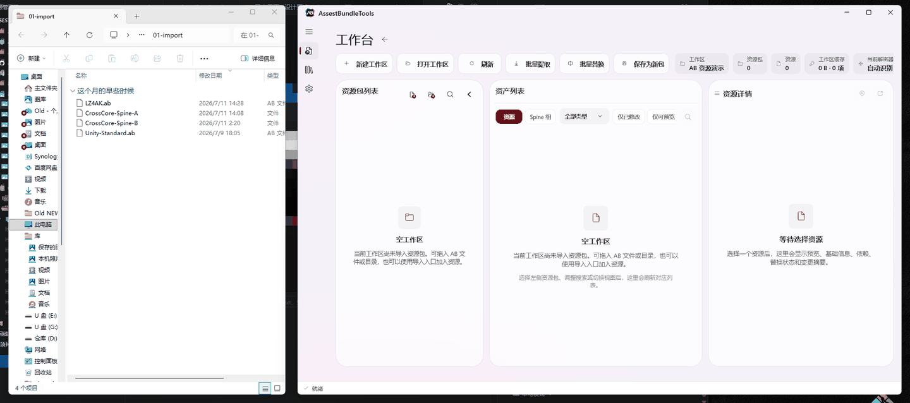

导入完成后检查顶部统计和左侧列表。自动模式会逐包保存实际命中的 codec 元数据，因此同一工作区可以同时包含 CrossCore、LZ4AK 和标准 UnityFS 包，导出时也能按各自来源格式回写。

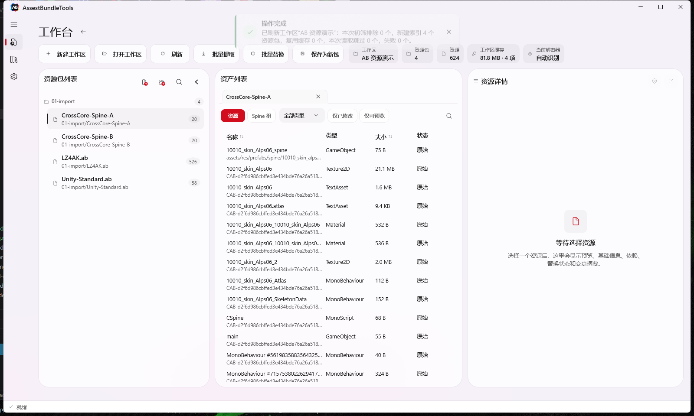

如果预期的文件没有出现：

1. 打开“设置与诊断 -> 日志中心”，查看初筛、Probe、Reader 和缓存诊断。
2. 确认当前解密器为“自动识别”，或改为该游戏明确要求的指定 codec 后重新导入。
3. 不要仅凭扩展名判断 AB；无扩展名文件同样可以导入，普通 PNG 改名为 `.ab` 也不会成为有效资源包。

## 4. 浏览、筛选与预览

选择左侧资源包后，中间列表支持类型筛选、搜索以及名称/大小正逆序排序。已打开的资源会保留在标签页中，切换筛选不会关闭当前预览。

Texture2D 预览提供缩放、棋盘背景、尺寸、编码和输出格式等信息。资源较大时预览会通过工作区缓存复用，不会每次切换都重新解析整个 AB。

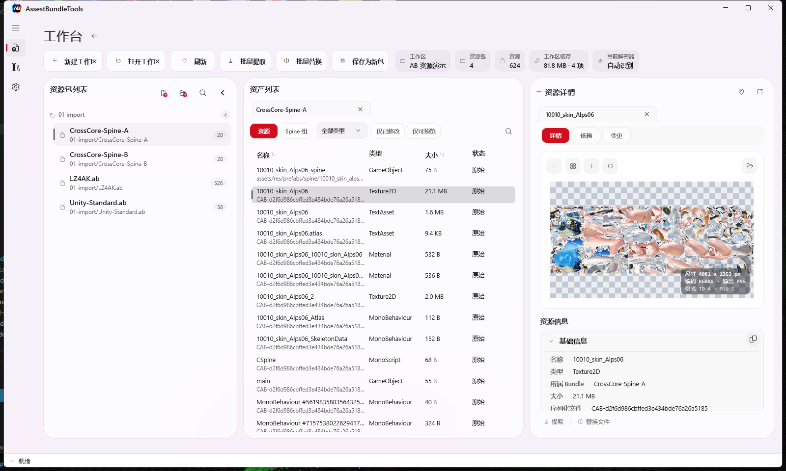

### 4.1 独立资源窗口模式

右侧“资源详情”的标签可以直接拖出主窗口，形成独立的资源预览/编辑窗口。也可以右键标签并选择“在新窗口中打开”；下面的演示使用右键入口以便清晰展示菜单，两种入口得到的窗口模式相同。

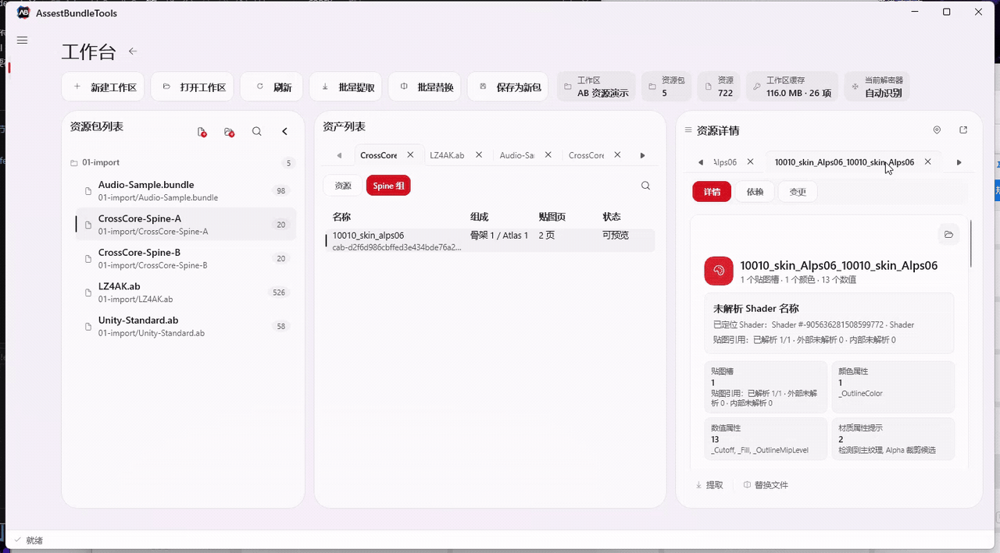

窗口模式适合需要较大画布、跨显示器对比或持续编辑的资源：左侧固定显示预览/编辑区域，右侧保留详情、依赖、替换和变更。普通资产与 Spine 组可以共用同一标签组，标签也能在主窗口和独立窗口之间移动。

独立窗口不是新的工作区副本。它与主窗口共享当前工作区、缓存、替换记录和导出计划；在任一窗口执行替换、撤销或重做，其他已打开视图会按受影响资源刷新。关闭窗口时默认把标签放回主窗口，也可以在偏好中改为直接关闭。

### 4.2 关联资源与依赖

“依赖”页不只用于查看引用路径，还用于判断一次修改会影响哪些资源：

- **直接依赖**：当前资源读取或渲染时直接使用的 Texture2D、Material、TextAsset 等资源。
- **反向引用**：当前资源被哪些 Sprite、Material、GameObject 或其他资产使用；替换前应优先检查这一组。
- **依赖闭包**：经过多层引用最终关联到的资源，并显示关系深度。
- **Bundle 外部依赖**：指向其他 CAB 或资源包的引用；解析成功时可以跳转到当前工作区中的实际资源。

可跳转的关联项使用 `BundleId + AssetId` 定位，而不是只依赖可能重复的 `PathId`。这可以避免多个资源包中相同 PathId 导致的误跳转。


关联关系还会参与预览和变更同步。例如 Sprite 使用关联 Texture2D 作为底图；替换贴图后，已打开的 Sprite 预览会刷新。Spine 组则由 skeleton、atlas、texture page 以及可能的独立 alpha 贴图组成，修改任一真实组成资产后，组预览和变更页会重新投影，但操作记录仍准确归属到被修改的真实资产。

关联刷新不代表应用会自动替换所有引用者。导出前仍应检查目标资源、反向引用和变更记录，并在游戏内验证材质、动画、场景切换等实际读取路径。

## 5. 替换普通资产

选中支持替换的资产，点击右下角“替换文件”，选择格式匹配的来源文件。下例把 Texture2D 替换为 PNG，并立即进入“变更”页核对来源路径。

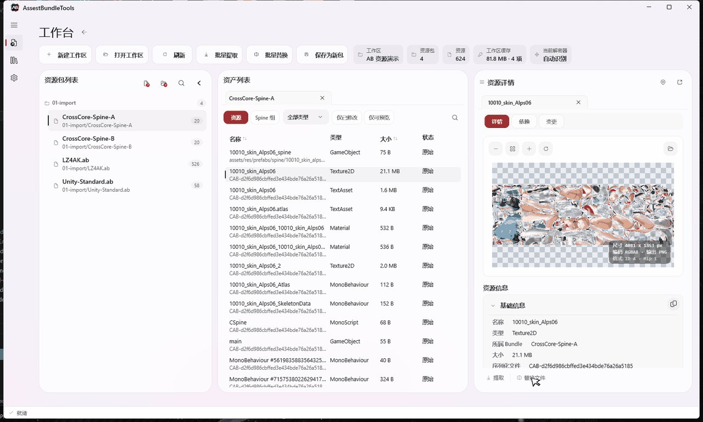

变更记录不会写回原始 AB。每条记录都可以撤销、重做或删除，列表状态也会同步显示“已修改”。


实际替换时应注意：

- 图片尺寸、透明通道和色彩空间应符合游戏资源的使用方式。
- 文件可被预览不等于一定能按原编码写回；导出阶段仍会执行格式转换和写后校验。
- 同一目标再次替换时，以当前生效记录为准，导出前应在“变更”页确认最终来源。

## 6. 替换 AudioClip

下面额外导入了一个含真实 `AudioClip` 的标准 UnityFS 演示包；导入方法与第 3 节完全相同。

筛选 `AudioClip` 后选择资源。详情页会显示容器、声道、采样率、时长和载荷位置；点击“替换文件”可以选择 WAV 等处理器支持的来源。

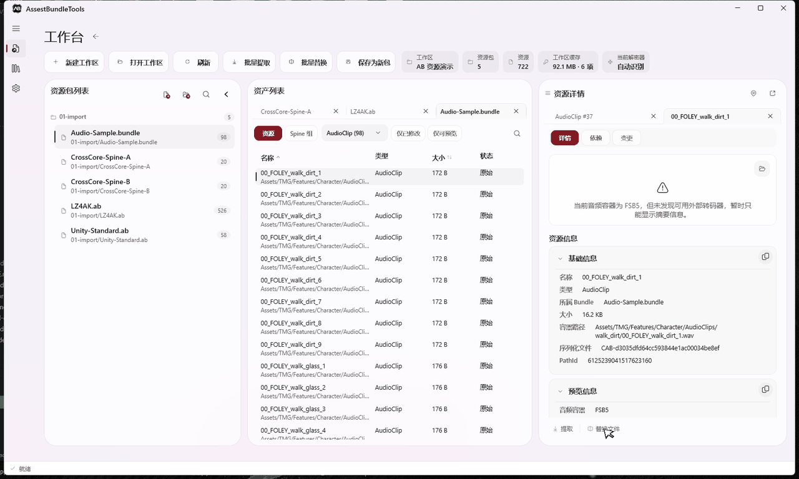

替换成功后，WAV 信息会进入预览，变更页保留完整来源路径。

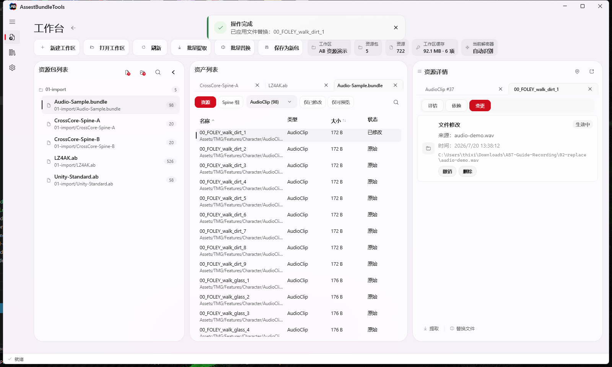

部分游戏音频使用 FSB5 等容器。缺少 `vgmstream-cli` 时，应用会先显示许可和可信下载来源，只有确认后才安装可选组件并重新加载预览。


音频导出还可能需要对应的编码处理器。不要为了绕过容器不匹配而默认启用“强制写入音频载荷”；该选项只适合已经确认目标容器和游戏读取行为的场景。

## 7. 预览、提取与替换 Spine 组

切换到“Spine 组”，应用会把 skeleton、atlas 和关联贴图聚合为一行。右侧可切换动画、skin、播放速度、缩放和背景；将组标签打开到独立窗口后可以获得更大的动画画布。

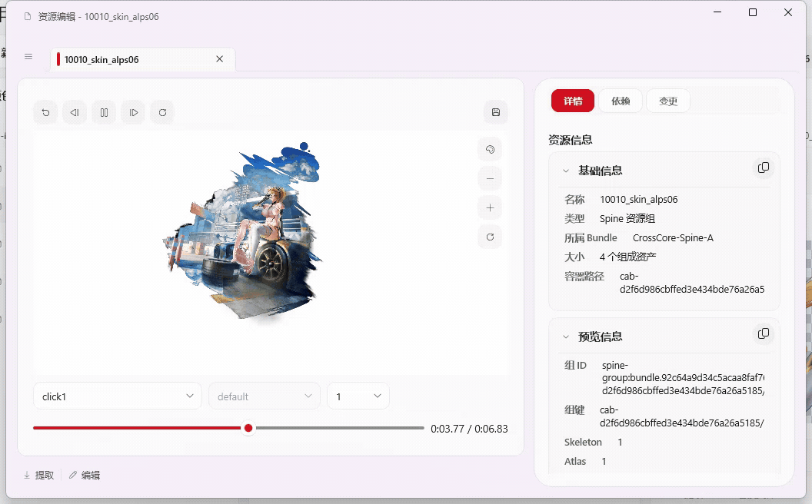

动画选择框用于切换当前 animation，skin 选择框切换真实皮肤，倍率选择框调整播放速度。顶部按钮提供播放/暂停、上一帧、下一帧、重播和 setup pose，底部时间轴可以拖动定位。预览按实际经过时间读取 runtime playback session 的当前帧，不要求预先生成整段动画帧。

当 skeleton 版本、attachment 或约束暂不受当前 runtime adapter 支持时，应用会显示结构化诊断并回退到可用摘要，而不是把空白画面当成成功。预览正常也不代表替换文件一定兼容目标游戏；保存和导出后仍需实际运行验证。

推荐先点击“提取”导出完整组，把生成目录作为替换模板。典型目录包含：

```text
10010_skin_alps06\
  10010_skin_Alps06.txt
  10010_skin_Alps06.atlas
  10010_skin_Alps06.png
  10010_skin_Alps06_2.png
```

编辑需要修改的文件后，把整个目录拖回对应 Spine 组。应用会先显示匹配数量，确认后才逐项创建替换记录；未匹配文件不会被静默写入。

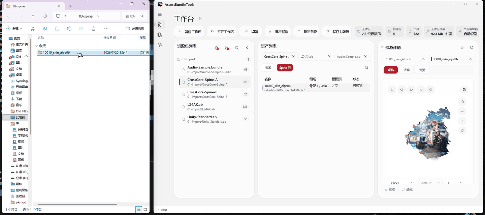

确认后应在“变更”页逐项检查 atlas 和贴图来源。演示中匹配了 atlas 与两张贴图，skeleton 未变化，因此没有创建无意义的替换记录。


## 8. 导出修改后的 AB

点击工作台顶部“保存为新包”。导出窗口只列出存在修改的资源包：

1. 选择要写出的资源包；不同游戏、不同 codec 的包可以分批导出。
2. 资源处理器保持“无处理器”，除非当前资源确实需要格式转换插件。
3. 一般保留“按照原加密导出”和“保持原压缩”。这会沿用每个 AB 导入时记录的 codec 与压缩方式。
4. 选择新的输出目录，确认计划摘要后开始导出。


完成后检查成功/失败数量。失败包不会被当作成功结果隐藏；详细 codec、处理器和写包错误可以在日志中心查看。


输出目录包含重新构建的 AB 和 `_abt-bundle-export-manifest.json`。清单记录输出 codec、处理器结果、文件哈希等信息，可用于批量替换回读和问题排查。

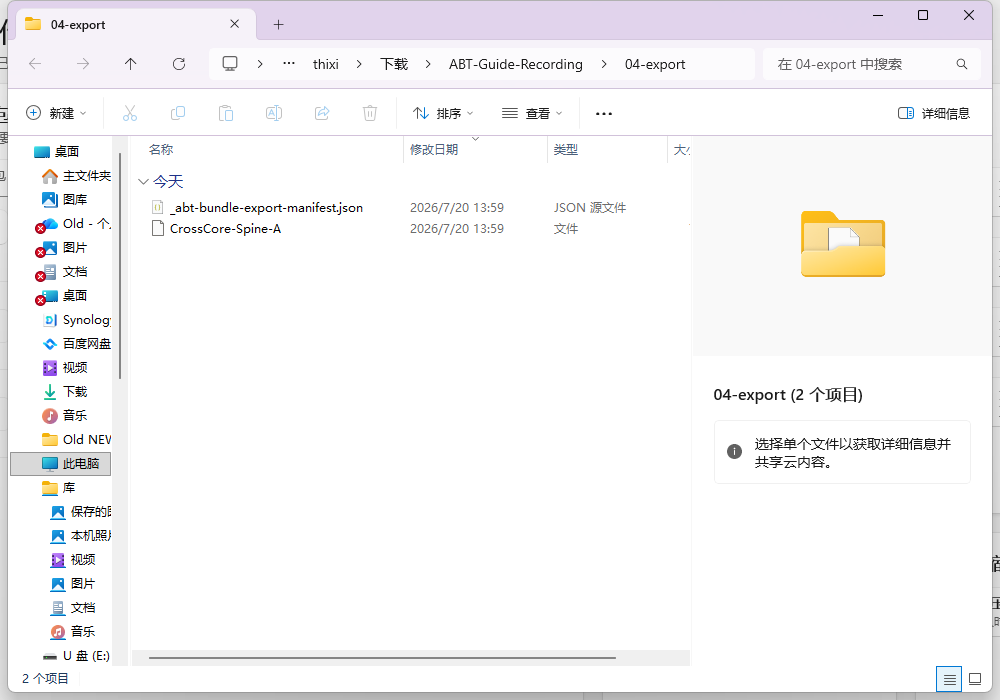

把 AB 放回游戏前，建议：

- 对照 manifest 确认输出路径、哈希和 codec；
- 保留游戏原文件，不直接覆盖唯一副本；
- 在与资源包匹配的游戏版本中测试预览、战斗和切换场景等实际读取路径。

## 9. 批量操作

工作台顶部提供“批量提取”和“批量替换”：

- 批量提取可按资源包和类型选择输出范围，适合一次导出多张贴图、音频或 Spine 组。
- 批量替换优先读取 AssestBundleTools manifest，随后使用大小、MD5 和启发式名称匹配生成计划。
- 执行前应核对匹配、跳过和冲突数量；批量操作同样写入可撤销的工作区记录。

对于第一次处理的新游戏，建议先用单资源流程验证一个包，再扩大到批量操作。

### 从资产列表批量拖拽替换

资产列表处于“全部类型”时，可以把多个文件、多个文件夹或两者混合后一次拖到任意普通资产行。拖入位置用于确认这是资产替换操作，应用会展开全部来源，并按文件名、资源类型匹配当前列表中的每个资产；匹配完成后只显示一次确认。

下面以 AudioClip 为例：先提取需要修改的音频并保留导出文件名，把编辑后的多个 WAV / OGG 放入同一目录，然后选中多个文件拖到资产列表，也可以直接拖入整个目录。确认“已按文件名匹配”的数量后执行，列表中的对应音频会一起进入“已修改”状态。

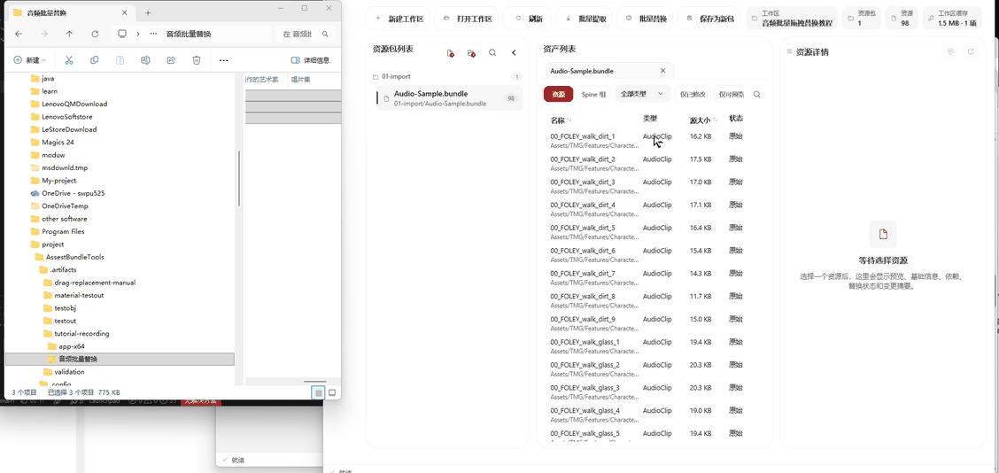

同名资产会在列表和导出文件中显示稳定编号，例如：

```text
shared_voice [1].wav
shared_voice [2].wav
```

批量拖拽时应保留这些 `[1]`、`[2]` 后缀，应用会按相同编号匹配目标。若改成不带编号的 `shared_voice.wav`，或者两个文件都可能命中同一资产，应用会列出冲突目标和完整来源路径，本次操作不会进入替换确认。不同类型可以使用相同基础名称，例如 `shared.png` 与 `shared.wav` 会分别匹配图片和音频；Texture2D 与 Sprite 都可接受 PNG，无法通过文件名消歧时同样会按冲突处理。

## 10. 插件管理

“插件管理”集中显示 AssetBundle codec、导出资源处理器和导出后处理三类插件。内置项可以验证、复制诊断和打开位置；用户管理的外部 CLI 也从这里注册和维护。

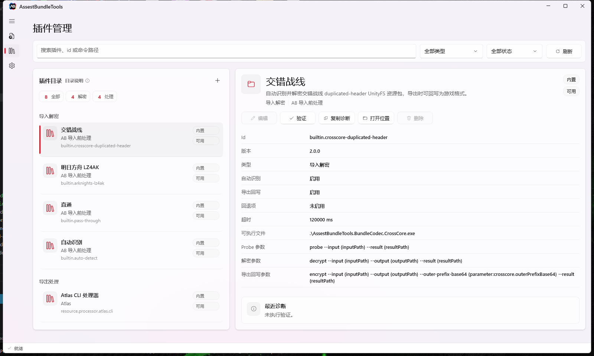

自动识别不是一次选择后固化整个工作区，而是对每个候选 AB 分别探测。导出时“按照原加密导出”使用的也是各包自己的来源 codec 元数据。

安装第三方插件前应确认来源可信。插件包目录、界面注册步骤和三类 CLI 的完整协议见 [插件开发与安装指南](plugin-guide.md)。

## 11. 诊断、缓存与更新

日志中心记录导入识别、拖放路由、替换匹配、处理器和写包结果。可以复制单条日志，也可以使用“复制全部”提交完整诊断。


性能与缓存页可以调整导入/预览并发，查看当前工作区缓存占用并显式清理。清理只移除可重建缓存，不会删除原始 AB 或变更来源文件。


“关于”页显示当前版本、GitHub 仓库、官网、[发布与赞助](https://www.modwu.com/10638.html)、[使用教程](https://www.modwu.com/10635.html)和手动更新入口。应用首次启动时会询问是否立即打开教程；选择暂不打开后，仍可随时从“设置与诊断 > 关于 > 使用教程”进入。发布版本也会在启动后检查 GitHub Releases。


## 12. 常见问题

### 拖入文件时鼠标显示禁止符号

普通权限应用无法接收来自低完整性级别不匹配窗口的拖放。优先以普通用户运行应用；如果系统默认强制管理员运行，可在偏好中启用实验性的管理员兼容拖放，并在日志中心查看精确命中区域和代理进程诊断。

### AB 已导入，但预览或读取失败

先看日志中的实际 codec、Probe 结果和 Reader 诊断。确认游戏版本、AB 来源和 sidecar 文件完整；不要用“直通”强行解析明确加密的包。

### 导出后游戏不识别

确认勾选“按照原加密导出”，压缩策略使用“保持原压缩”，并检查 manifest 中的输出 codec。CrossCore v2、LZ4AK 等格式必须按导入时记录的原始变体回写，标准 LZ4 不能替代游戏专用外层格式。

### 音频预览失败

FSB5 等容器需要可选转码器。按应用确认框从可信来源安装，或在插件管理中查看音频处理器状态。预览转码器与导出编码处理器承担不同职责，预览可用不代表一定能重新编码写回。

### 工作区越来越大

在“性能与缓存”查看缓存占用并清理当前工作区。工作区元数据、可恢复操作记录和页面临时状态彼此独立，清缓存后首次预览会重新生成，随后继续复用。
